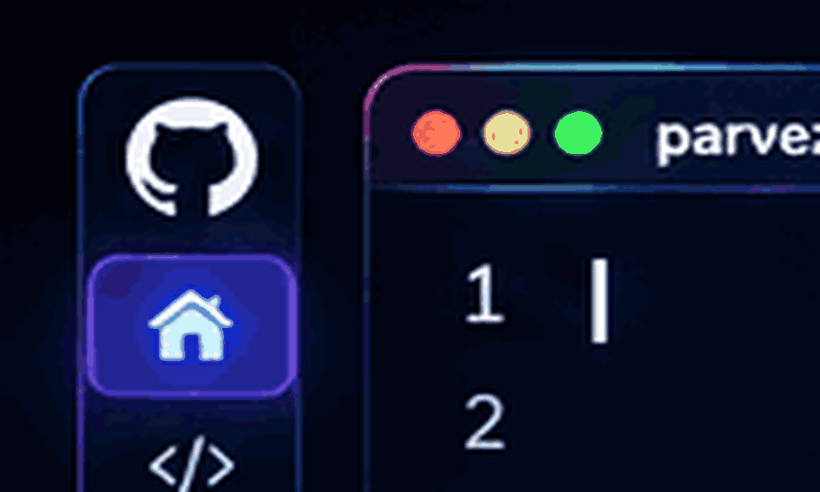

# MD PARVEZ HASAN

**ASPIRING AI ENGINEER · SOFTWARE DEVELOPER · RESEARCH ENTHUSIAST**

[⌘ GitHub](https://github.com/parvezrepository) · [in LinkedIn](https://www.linkedin.com/in/parvez-hasan-934611414/) · 🇧🇩 Bangladesh

---

<table width="100%">
<tr>
<td width="55%" valign="top">

### ◈ ABOUT

CSE student at **Daffodil International University**.

Interested in Artificial Intelligence, software engineering, and academic research.

**Mission:** Learn deeply. Build intelligently. Innovate meaningfully.

</td>
<td width="45%" valign="top">

### ◈ FOCUS

🧠 Artificial Intelligence

💻 Software Engineering

🔬 Academic Research

⚙️ Automation & SaaS

</td>
</tr>
</table>

---

### ⚡ TECHNOLOGY STACK

`Python` `JavaScript` `TypeScript` `Java` `Dart`

`React` `Node.js` `Express` `Flask`

`PostgreSQL` `Supabase` `Firebase`

`Git` `Docker` `Linux`

---

### 🔬 RESEARCH & INTERESTS

`Machine Learning` · `Deep Learning` · `AI Applications`

`Literature Review` · `Research Papers` · `Data Analysis`

---

### 🚀 LEARN → RESEARCH → BUILD → INNOVATE

[↗ EXPLORE PROJECTS](https://github.com/parvezrepository?tab=repositories) · [↗ LET'S CONNECT](https://www.linkedin.com/in/parvez-hasan-934611414/)

 

*"Think beyond limitations. Build beyond expectations."*

**© 2026 MD PARVEZ HASAN**

